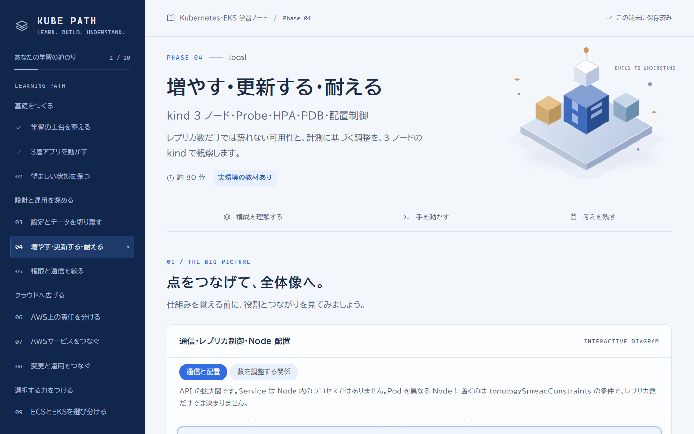
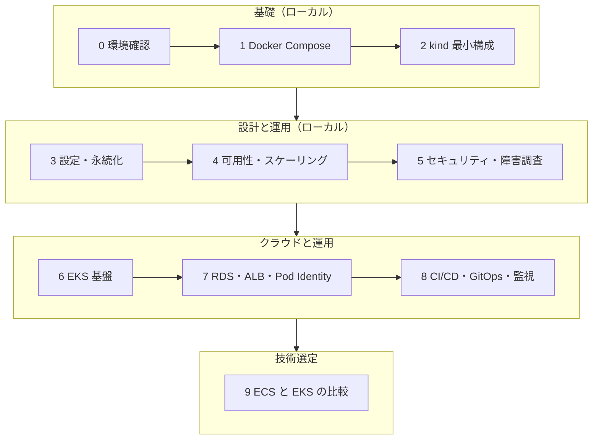
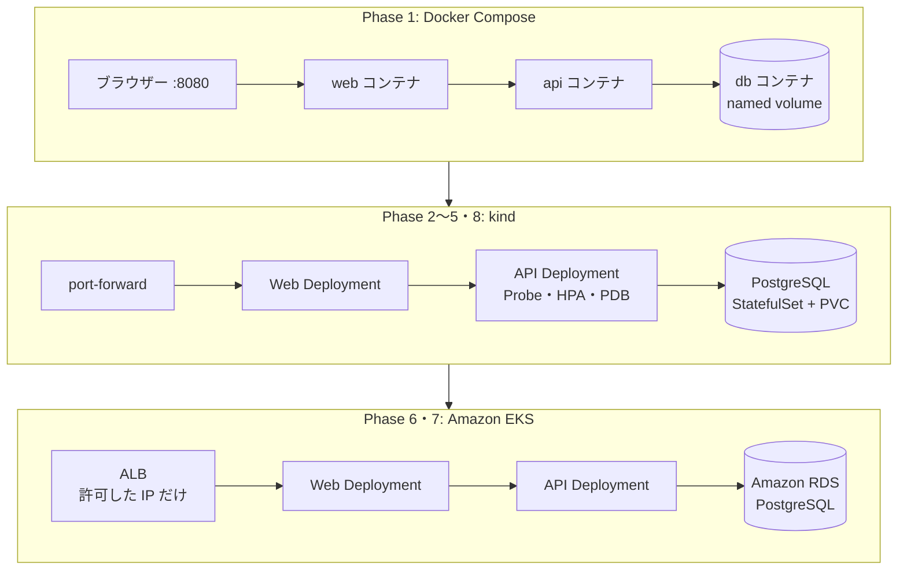
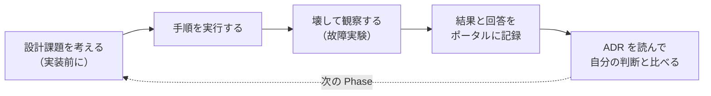
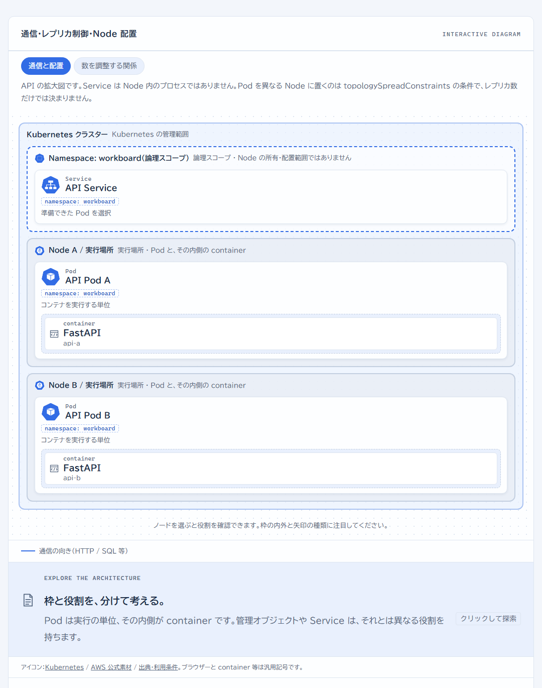
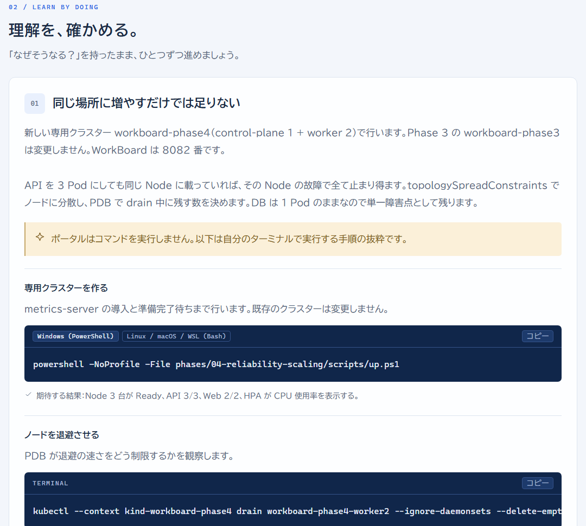
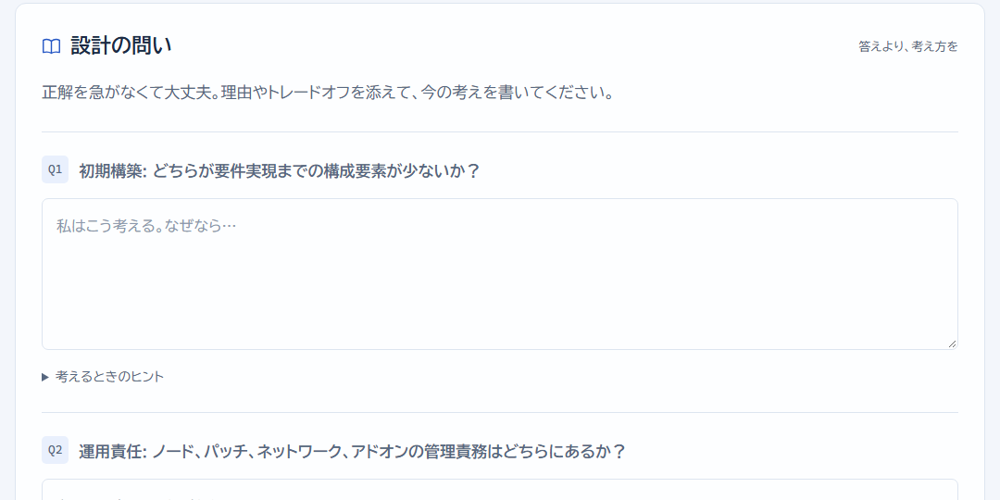

# Kubernetes / Amazon EKS 学習教材

簡易タスク管理アプリ **WorkBoard** を題材に、コンテナから Kubernetes、AWS 上の設計・運用判断までを 10 の Phase で段階的に学ぶハンズオン教材です。各 Phase で「設計課題を考える → 動かす → 壊して観察する → 判断を記録する」を繰り返し、「`kubectl apply` が成功した」で終わらせずに、なぜその構成なのかを説明できるようになることを目指します。



## この教材で学べること

- **コンテナと Kubernetes の基本:** Docker Compose から始め、Pod・Deployment・Service・StatefulSet・PVC・ConfigMap/Secret を、同じアプリを動かしながら比べます。
- **可用性と運用:** Probe、requests/limits、HPA、PodDisruptionBudget、ノードへの分散を、3 ノードの kind で負荷や障害を起こして観察します。
- **セキュリティと障害調査:** RBAC、NetworkPolicy（Calico）、Pod Security Standards を設定し、意図的な故障から原因をたどる Runbook を作ります。
- **AWS との連携:** Terraform で VPC・EKS・RDS・ALB・Pod Identity を設計し、費用・公開範囲・削除手順を先に決めてから構築します。
- **DevOps と可観測性:** GitHub Actions の CI/CD、Argo CD による GitOps、Prometheus のメトリクスと SLO を扱います。
- **技術選定:** 同じ要件で ECS と EKS を比べ、採用案と反対案を根拠つきで書きます。

## 学習の流れ



Phase 0〜5 はローカルだけで完結し、AWS の費用はかかりません。Phase 6・7 は AWS の有料リソースを使います。Phase 8 の GitOps と監視は kind 上で試せるので、AWS を使わずに進めることもできます（CD ワークフローだけは AWS が必要です）。

## WorkBoard の構成の移り変わり

同じ WorkBoard（Nginx の Web、FastAPI の API、PostgreSQL）を、実行基盤を変えながら動かします。



各 Phase の詳しい構成図は、それぞれの `architecture.md` にあります。

## Phase 一覧

| Phase | 題材 | 実行環境 | WorkBoard のポート | 資材 |
| --- | --- | --- | --- | --- |
| 0 | リポジトリ基盤と環境確認 | ローカル | — | [phases/00-foundation](phases/00-foundation/README.md) |
| 1 | Docker Compose と WorkBoard MVP | Docker Compose | 8080 | [phases/01-compose](phases/01-compose/README.md) |
| 2 | kind による Kubernetes 最小構成 | kind `workboard-lab` | 8080 | [phases/02-kind-basics](phases/02-kind-basics/README.md) |
| 3 | 設定・Secret・永続化 | kind `workboard-phase3` | 8081 | [phases/03-config-storage](phases/03-config-storage/README.md) |
| 4 | 可用性・更新・スケーリング（Probe・HPA・PDB・配置制御） | kind `workboard-phase4`（3 ノード） | 8082 | [phases/04-reliability-scaling](phases/04-reliability-scaling/README.md) |
| 5 | セキュリティ・障害調査（RBAC・NetworkPolicy・PSS・Runbook） | kind `workboard-phase5`（Calico） | 8083 | [phases/05-security-and-failure](phases/05-security-and-failure/README.md) |
| 6 | EKS 基盤（Terraform・VPC・Managed Node Group・ECR） | AWS（有料） | 8086 | [phases/06-eks-foundation](phases/06-eks-foundation/README.md) |
| 7 | AWS マネージドサービス連携（RDS・ALB・Pod Identity・Helm） | AWS（有料） | ALB | [phases/07-aws-integration](phases/07-aws-integration/README.md) |
| 8 | DevOps・可観測性（CI/CD・Argo CD・Prometheus・SLO） | kind `workboard-phase8`、CD は AWS | 8084（Argo CD 8085、Prometheus 8087） | [phases/08-devops-observability](phases/08-devops-observability/README.md) |
| 9 | ECS と EKS の採用判断 | 机上（クラウド操作なし） | — | [phases/09-architecture-review](phases/09-architecture-review/README.md) |

kind の各 Phase は専用のクラスターと kubeconfig とポートを使うため、他の Phase の環境を壊しません。各 Phase のディレクトリは他の Phase に依存せず、単独で動きます（[ADR-0007](docs/adr/0007-phase-directory-layout.md)）。

> [!WARNING]
> Phase 6・7 は **AWS の有料リソース** を作ります。Terraform・マニフェスト・スクリプトは静的検証（`terraform validate`、`helm template`、`kubectl kustomize`）まで済んでいますが、AWS 上での動作は未検証です。各 README の開始条件（明示的な判断、見積もり、予算通知、削除手順の確認）を満たしてから、自分で実行してください。

## はじめかた

1. このリポジトリを clone します。Phase 8 で Argo CD を試すなら、先に自分のアカウントへ fork してから clone します。
2. 必要なツールがそろっているかを確認します（バージョンを表示するだけで、何もインストールしません）。

   **Windows (PowerShell):**

   ```powershell
   powershell -NoProfile -File .\tools\preflight.ps1
   ```

   **Linux / macOS / WSL (Bash 4 以降):**

   ```bash
   bash tools/preflight.sh
   ```

3. 学習ポータルを起動して [http://127.0.0.1:8765](http://127.0.0.1:8765) を開きます。

   **Windows (PowerShell):**

   ```powershell
   powershell -NoProfile -File tools/start-learning.ps1
   ```

   **Linux / macOS / WSL (Bash 4 以降):**

   ```bash
   bash tools/start-learning.sh
   ```

4. Phase 0 から順に進めます。前の Phase を終えてから次へ進みます。

## 1 つの Phase の進め方



1. 各 `phases/NN-*/README.md` の「設計課題」に、手を動かす前に自分の考えを書きます。
2. 「検証コマンド・期待結果」の手順を実行し、期待どおりかを確かめます。
3. 「故障実験」で意図的に壊し、何が起き、どう戻るかを観察します。
4. 観察結果と設計課題への回答は、README ではなく **学習ポータル** に記録します。記録は各自の PC の Git 管理外（`learning-portal/.data`）にだけ保存されます。
5. 設計課題に答えた **後で**、その Phase の `decisions/` にある ADR（設計判断の記録）を読み、自分の回答と比べます。ADR は答えにあたる内容を含むため、先に読まないでください。全 ADR の一覧は [docs/adr/README.md](docs/adr/README.md) にあります。

## 学習ポータル

教材・構成図・用語・コマンドをブラウザーで読み、メモと設計課題への回答をローカルに保存する Web アプリです。WorkBoard・kind・Pod・port-forward は操作しません。

**構成図で、通信・管理・配置の関係を確かめる**

ノードを選ぶと役割を確認でき、表示を「通信と配置」「数を調整する関係」などに切り替えられます。



**手順を、自分のシェルで実行する**

コマンドは Windows（PowerShell）と Linux / macOS / WSL（Bash）を切り替えて表示し、期待する結果を添えています。ポータルはコマンドを実行しません。



**設計課題に答え、AI で振り返る**

回答とメモはこの PC にだけ保存されます。Codex CLI または Claude Code CLI にログインしていれば、操作したときだけ回答を送って採点と補足を受けられます（任意）。



起動・保存先・AI 採点の詳しい説明は [learning-portal/README.md](learning-portal/README.md) にあります。

## 必要なソフトウェア・ツール

自分の PC に導入するものです。版はこの教材で確認した条件で、各 Phase の README の「前提条件」が正本です。Git・Docker・Docker Compose・kubectl・kind・Python・Node.js・AWS CLI・Terraform の導入の有無と版は、`tools/preflight.ps1`（Bash は `tools/preflight.sh`）で確認できます（参照のみで、何もインストールしません）。Helm・k9s・採点用の CLI は preflight の対象外です。

| ソフトウェア | 版の条件 | 使う Phase | 用途・備考 |
| --- | --- | --- | --- |
| Git | 指定なし | すべて | clone、Phase 8 では自分の fork への push |
| PowerShell または Bash | PowerShell 5.1 以降 / Bash 4 以降（macOS 標準の bash 3.2 は不可） | すべて | スクリプトの実行。どちらか一方でよい |
| Python | 3.11 以降 | 学習ポータル、7 | 学習ポータルの教材生成とサーバー、Phase 7 の Bash 版 `write-db-secret.sh`（`python3`）。WorkBoard の API とテストはコンテナ内で動くので不要 |
| Node.js / npm | Node.js 20.19 以降の 20 系、または 22.12 以降 | 学習ポータル | 学習ポータルの画面のビルド（初回の `npm` 導入にネットワークが必要）。WorkBoard の Web はコンテナ内でビルドするので不要 |
| Docker / Docker Compose | Linux コンテナが動くこと、Compose v2（`docker compose`）（Windows / macOS は Docker Desktop、Linux は Docker Engine または Docker Desktop。WSL は Docker Desktop の WSL 統合） | 1〜8 | Compose、イメージのビルド、kind のノード。Phase 4・8 は 3 ノードの kind のため、Docker のメモリに 6 GiB 程度の空きを推奨 |
| kubectl | 1.34〜1.36 | 2〜8 | Kubernetes の操作（Kustomize の `kubectl kustomize` を含む）。Docker Desktop 同梱のものでもよい |
| kind | v0.33.0 | 2〜5、8 | ローカルの Kubernetes。`tools/kind-install.ps1`（Bash は `tools/kind-install.sh`）が Git 管理外の `.tools/` に導入する |
| curl | 指定なし | 1〜8 | 動作確認。Windows は標準の `curl.exe` |
| Terraform | 1.17.x | 6〜8 | AWS 環境の定義。`plan` / `apply` は AWS の承認後だけ |
| AWS CLI | v2 | 6〜8 | 認証、ECR へのログイン、kubeconfig の更新、残った資産の点検 |
| Helm | 4.x（4.3.1 で確認） | 7 | AWS Load Balancer Controller の導入と `helm template` |
| k9s | 指定なし（任意） | 5 | Runbook を `kubectl` で終えた後の観察用。導入しなくても Lab は完了できる |
| Codex CLI / Claude Code CLI | 指定なし（任意） | 学習ポータル | 「AI と理解を振り返る」の採点。ログイン済みのどちらかがあれば使える。採点モデルの既定は `gpt-6-luna` / `claude-sonnet-5-5`（変更方法は [learning-portal/README.md](learning-portal/README.md)） |

アカウントが必要なもの:

- **AWS アカウント（Phase 6〜8）:** 有料リソースを作ります。各 Phase の開始条件を満たしてから使います。
- **GitHub アカウント（Phase 8）:** Argo CD は自分の fork を同期します。CI/CD を試す場合も自分の fork で行います。

Calico、metrics-server、Argo CD、Prometheus、AWS Load Balancer Controller は、構築スクリプトや Helm がクラスターの中に入れるもので、PC への導入は不要です（版は各 Phase の README と ADR に固定してあります）。

## 対応環境

Windows（PowerShell 5.1 以降）と Linux / macOS / WSL（Bash 4 以降）の両方で使えます。各スクリプトは `.ps1` と同じ場所に同じ処理の `.sh` があり、ラボ README には両方のコマンドを並べています。方針と実機での確認範囲（Windows と WSL2 Ubuntu で確認、ネイティブ Linux・macOS は未確認）は [ADR-0008](docs/adr/0008-linux-support.md) にあります。preflight の観測結果と未検証事項は [Phase 0 の実装時検証記録](phases/00-foundation/README.md#実装時の検証記録) にあります。

## リポジトリ構成

```text
kubernetes-eks-learning/
├── app/                 全 Phase で共通の WorkBoard（api: FastAPI、web: Nginx + TypeScript）
├── phases/
│   └── NN-xxx/          Phase ごとのラボ手順（README）、構成図（architecture.md）、
│                        マニフェスト、スクリプト、Terraform、設計判断（decisions/）
├── tools/               共通スクリプト（preflight、kind の導入と共通処理、学習ポータルの起動）
├── learning-portal/     学習ポータル（Python の標準ライブラリのサーバー + React の画面）
├── docs/                一次設計書、全体に関わる ADR（docs/adr/）、README の画像
└── .github/workflows/   CI（テスト・ビルド・マニフェストと Terraform の検証）と、手動承認制の CD
```

`.tools/`（kind の実行ファイル）と `.kube/`（学習専用の kubeconfig）は、各自の PC に作られる Git 管理外のディレクトリです。設計の全体像は [一次設計書](docs/PROJECT_DESIGN.md) と [技術選定 ADR](docs/adr/0001-application-and-learning-stack.md) にあります。

## 安全に学ぶための約束

- **データを消す操作は、対象と影響を確かめてから行います。** `docker compose down -v` や `kind delete cluster` は DB のデータも消します。Phase 3 以降の PVC もバックアップではありません。
- **AWS の有料リソースは、対象・費用・公開範囲・削除手順を確認してから作ります。** 予算通知は課金を止めません。使い終わったら各 Phase の `aws-cleanup.md` の手順で削除します。
- **認証のない WorkBoard をインターネットに公開し続けません。** ALB での公開は短時間の検証用で、許可した IP だけに絞ります。
- **認証情報や実パスワードを Git に入れません。** `.env`、各 Phase の `secrets/*.env`、tfstate、tfvars は Git 管理外です。例示ファイルにはダミー値だけを使います。
