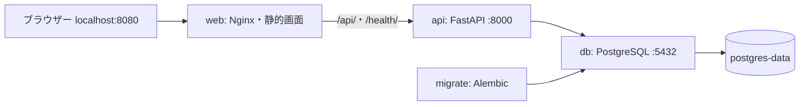

# Phase 1: Compose の構成

ホストへ公開するのは `127.0.0.1:8080` だけ。API と DB は Compose のネットワーク内で `api`・`db` というサービス名から接続します。`localhost` は各コンテナ自身を指すため、API から DB に接続するときは使いません。

画面は相対パス `/api/v1/tasks` を呼び、Nginx がパスを保ったまま API へ転送します。同じオリジンなので CORS 設定は不要です。Nginx の resolver は Docker の組み込み DNS を使い、API コンテナ再作成時の IP 変更を追従します。Kubernetes へ進む際は接続先と resolver をその環境用に変更します。

## 起動と障害時の境界

1. DB コンテナが起動する。
2. `pg_isready` が成功してから、一回実行の `migrate` が `alembic upgrade head` を行う。
3. migration の成功後に API が起動する。
4. API の Readiness 成功後に Web が起動する。

`depends_on` の単純な記述は起動順だけです。上記では `service_healthy` と `service_completed_successfully` を使います。これらは起動時の条件であり、起動後に DB が止まっても Compose が依存サービスを自動で修復する保証はありません。

Liveness は API プロセスだけを確認し、DB を参照しません。Readiness は DB への `SELECT 1` で接続を確認します。DB 停止時は Liveness が 200、Readiness が 503 になります。SQLAlchemy の `pool_pre_ping` は古い接続を検出しますが、実行中の書き込みを自動再試行しません。二重作成を避けるため、失敗した操作は画面で確認してから再実行します。

## データとテスト

タスクは PostgreSQL の名前付き volume `workboard_postgres-data` に保存します。API の再起動、ブラウザーの再読込、通常の `docker compose down` では残ります。ホストの障害・volume の削除に対するバックアップではありません。

API テストは `test` profile の専用 `db-test` に接続します。DB 名は `workboard_test`、保存先は tmpfs です。テストは毎回タスクを消去するため、学習用 `db` から分離し、テストコードでも DB 名を確認します。

認証情報は root の `.env` に置き、Compose の `env_file` で API・DB・migration に渡します。接続 URL は SQLAlchemy の `URL.create` で組み立て、パスワードの記号も安全に扱います。Web のビルドには渡しません。
