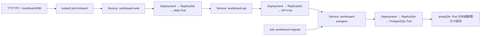

# Phase 2: kind 上の WorkBoard

kind は Docker のコンテナを Kubernetes のノードとして使います。今回は control-plane 兼ワーカーノードを1台だけ作ります。API Server は宣言された状態を受け付け、コントローラーはその状態に近づけ、スケジューラーと kubelet が Pod の配置・実行を担います。

Deployment は Pod のテンプレートと必要数を宣言します。Deployment が ReplicaSet を管理し、ReplicaSet が Pod 数を維持します。Pod を削除すると同じ Pod が復活するのではなく、新しい名前・UID の Pod が作られます。

Service は label/selector で転送対象を選びます。API Pod の IP が変わっても、Web は `workboard-api.workboard.svc.cluster.local:8000` を使い続けます。CoreDNS が Service 名を解決し、Service は利用可能な EndpointSlice の宛先へ通信を転送します。

Nginx は Compose と同じイメージ・設定テンプレートを使います。公式イメージの entrypoint が `/etc/resolv.conf` から DNS サーバーを取得してテンプレートへ反映します。Compose 固有の `127.0.0.11` を Kubernetes へ持ち込みません。違いは API の接続先を表す環境変数だけです。

## Compose との違い

| 観点 | Phase 1: Compose | Phase 2: Kubernetes |
| --- | --- | --- |
| 宣言の適用 | `docker compose up` | `kubectl apply` |
| 実行単位 | サービスのコンテナ | Pod 内のコンテナ |
| Pod/コンテナ削除後 | Compose 操作や再起動ポリシーに依存 | ReplicaSet が必要な Pod 数へ戻す |
| 安定した接続先 | Compose のサービス名 | ClusterIP Service と DNS |
| ホストからの入口 | Web のポート公開 | Web Service への port-forward |
| 起動依存 | `depends_on` の条件 | 構築スクリプトで DB の準備・Job 完了を待つ |
| DB の保存先 | 名前付き volume | 一時的な emptyDir |

最低限の readinessProbe は、構築時に DB/API の準備を待ち、準備できた Pod を Service の宛先にするために使います。Liveness/Startup probe の設計、負荷・更新・可用性の実験は Phase 4 で扱います。今回の構成は単一ノード・各1 Pod であり、高可用性はありません。

## データの寿命

API Pod を削除しても DB Pod が残っていればタスクは残ります。一方、DB Pod を削除すると emptyDir とタスク・スキーマが消えます。新しい DB Pod が起動しただけではテーブルは戻りません。migration Job を再実行してスキーマを作成しますが、元のタスクは復元できません。

Phase 2 はダミーデータ専用です。Compose の `.env`・DB・volume からデータを移しません。PVC/StatefulSet と設定分離は Phase 3 の課題です。

## クラスターの選択

操作には専用 `.kube/workboard-kind.yaml` と `--context kind-workboard-lab` を使います。Windows では `scripts/kind-env.ps1` を現在の PowerShell に読み込むと、専用 kubeconfig と `.tools` の kind がこのシェルだけで有効になります。ユーザーの標準 kubeconfig やシステム PATH は書き換えません。
