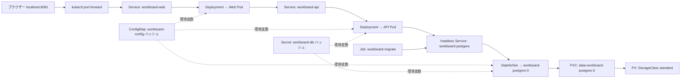

# Phase 3: 設定・機密情報・永続化

Phase 2 と同じ WorkBoard を、新しい kind クラスター `workboard-phase3` に配置します。Phase 2 のクラスター `workboard-lab` は変更しません。この Phase の資材は `phases/03-config-storage/` だけで完結し、Phase 2 のディレクトリを参照しません。そのため Web/API の定義や kind の `cluster.yaml` は Phase 2 と重複して存在します。これは Phase を独立させるための意図的な重複です（[ADR-0007](../../docs/adr/0007-phase-directory-layout.md)）。

## Kustomize の構成

| 場所 | 役割 |
| --- | --- |
| `kustomize/base/` | Web/API の Deployment と Service、migration Job。環境依存の値は書かず、ConfigMap `workboard-config`・Secret `workboard-db` を参照するだけ |
| `kustomize/components/postgres-local/` | ローカル用の PostgreSQL。StatefulSet（`volumeClaimTemplates`）と headless Service。RDS を使う環境ではこの component を含めない |
| `kustomize/overlays/kind/` | Namespace、`:kind` タグのイメージ、`imagePullPolicy: Never`、ConfigMap と Secret の生成 |

overlay は base の YAML に対する変更（namespace の付与、イメージ名・タグの置換、パッチ、名前参照の書き換え）と、generator による ConfigMap/Secret の生成を行います。変数展開や条件分岐を行うテンプレートエンジンではなく、base に存在しないリソースを自動では作りません。Secret の入力 `secrets/db.env` は Git 管理外で、`db.env.example` にダミー値だけを置きます。

ConfigMap と Secret の名前には内容のハッシュが付きます。Kustomize は参照している Deployment・StatefulSet・Job の名前も同じハッシュ付きの名前に書き換えます。値を変えると名前が変わり、Pod テンプレートが変わるため、参照している Deployment と StatefulSet は新しい Pod へ置き換えられます。同じ ConfigMap を 3 つのワークロードが共有しているため、1 つの値の変更でも DB Pod が再作成されます（データは PVC に残ります）。旧い ConfigMap/Secret は自動で削除されません。

## 永続化

PostgreSQL は Deployment ではなく StatefulSet です。Pod 名は `workboard-postgres-0` で固定され、`volumeClaimTemplates` から Pod 専用の PVC `data-workboard-postgres-0` が作られます。StorageClass は指定せず、クラスターの既定（kind では `standard`、local-path のプロビジョナー）を使います。PVC は Namespace に属し、PV はクラスター全体のオブジェクトです。

- Pod を削除して作り直しても、同じ名前の Pod が同じ PVC を使うためタスクは残ります。
- StatefulSet を削除しても PVC は残ります（既定の保持動作）。
- PVC を削除すると、`standard` の reclaim policy は `Delete` のため PV とデータも消えます。
- kind の保存先はノード（Docker コンテナ）内のディレクトリです。ノードやクラスターの削除、誤削除、バックアップの代わりにはなりません。PV はノード喪失を含めた可用性の保証ではありません。

DB の Service は headless（`clusterIP: None`）で、StatefulSet の `serviceName` と対応します。API は `workboard-postgres` の名前で Pod の IP に解決されます。

## migration Job

Alembic の `upgrade head` は何度実行しても安全です。Job の `spec.template` は作成後に変更できず、ConfigMap/Secret のハッシュ名が変わると apply が失敗するため、構築スクリプトは完了済み Job を毎回削除してから `apply -k` します。Job の初期化コンテナが `pg_isready` で DB の接続可能を待つので、DB の初回起動が遅くても Job の失敗回数を使い切りません。

## Secret の扱い

Secret の値は base64 で表現されますが、暗号化ではありません。`kubectl get secret` で読める主体、Pod に `exec` できる主体、環境変数として渡された Pod からは値を取得できます。保存時の暗号化、RBAC、監査は別に設計します。この kind クラスターには保存時暗号化を設定しておらず、検証もしていません。実パスワードはリポジトリに含めず、構築スクリプトがローカル専用のランダムな値を `db.env` に生成します。DB を初期化した後に値を変えても、既存 DB のパスワードは変わりません。

## Phase 2 との違い

| 観点 | Phase 2 | Phase 3 |
| --- | --- | --- |
| クラスター | `workboard-lab` | `workboard-phase3`（別クラスター） |
| 適用方法 | `kubectl apply -f phases/02-kind-basics/manifests/*.yaml` | `kubectl apply -k phases/03-config-storage/kustomize/overlays/kind` |
| DB | Deployment と emptyDir | StatefulSet と PVC |
| 設定・DB パスワード | マニフェストに直書き | ConfigMap と Secret |
| ホストの入口 | 8080 | 8081 |
