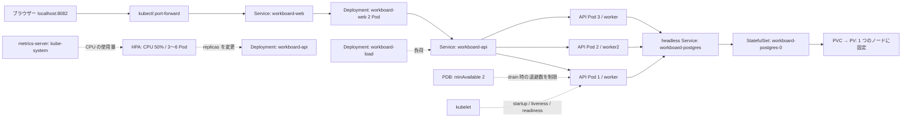

# Phase 4: 可用性、更新、スケーリング

## 構成

| 要素 | 役割 |
| --- | --- |
| kind クラスター `workboard-phase4` | control-plane 1 と worker 2。Pod は worker 2 台に配置される（control-plane は taint で除外） |
| API Deployment | 3 レプリカ。RollingUpdate は `maxSurge: 1` / `maxUnavailable: 0`。`topologySpreadConstraints` でノードに分散 |
| Probe | startup と liveness は `/health/live`（DB 非依存）、readiness は `/health/ready`（DB 接続を確認） |
| PodDisruptionBudget | API は常に 2 Pod 以上を維持する範囲でだけ、`drain` などの自発的な退避を許す |
| HPA | CPU 使用率が requests の 50% になるよう 3〜6 Pod に増減する |
| metrics-server | `kubectl top` と HPA が使う CPU/メモリの値を提供する（kube-system） |
| `load/load-generator.yaml` | HPA 観察用。クラスター内から Service `workboard-api` だけを叩く |
| `scripts/watch-http.*` | 8082 番への HTTP 応答を一定間隔で記録し、復旧時間を測る |

DB（PostgreSQL）は Phase 3 と同じ 1 Pod の StatefulSet です。可用性を上げた対象は Web と API だけで、DB は単一障害点のままです。
