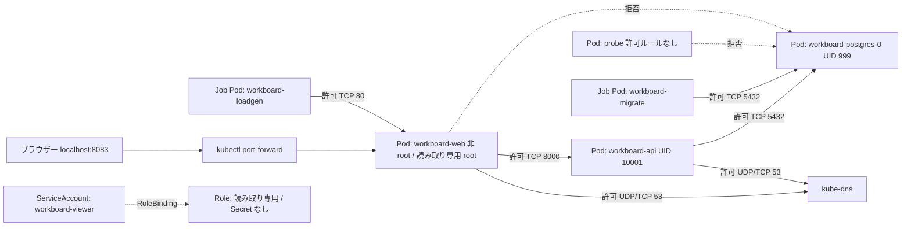

# Phase 5: セキュリティ、障害調査、運用

Phase 3 と同じ WorkBoard を、新しい kind クラスター `workboard-phase5` に配置します。ほかのクラスターは変更しません。この Phase の資材は `phases/05-security-and-failure/` だけで完結し、Phase 3 のディレクトリを参照しません。Web/API/DB の定義や Secret の入力ファイルの形は Phase 3 と重複しています。これは Phase を独立させるための意図的な重複です（[ADR-0007](../../docs/adr/0007-phase-directory-layout.md)）。

## 防御の層

| 層 | 何を制限するか | この Phase の資材 |
| --- | --- | --- |
| Pod Security Admission | Pod の作成時に、特権・root・危険な設定を拒否する | `namespace.yaml` の `pod-security.kubernetes.io/*` ラベル（restricted） |
| securityContext | コンテナのプロセスの権限（ユーザー、ファイル書き込み、capability、seccomp） | 各 Deployment / StatefulSet / Job |
| ServiceAccount と RBAC | Kubernetes API を誰が何に対して操作できるか | ワークロードごとの ServiceAccount（トークン自動マウントなし）、`workboard-viewer` の Role と RoleBinding |
| NetworkPolicy | Pod 間・Pod から外への通信 | default deny + 必要な経路だけの許可（`networkpolicy.yaml`） |
| リソース制限 | メモリを使い過ぎる Pod の影響範囲 | `resources.limits.memory` |

どの層も、ほかの層の代わりにはなりません。たとえば、NetworkPolicy で DB への通信を絞っても、Secret を読める人は API 経由でパスワードを取得できます。

## CNI と NetworkPolicy

NetworkPolicy は API のオブジェクトで、実際に通信を遮断するのは CNI プラグインです。対応しない CNI では、作成に成功しても通信は遮断されません。この Phase の `cluster.yaml` は kind の既定 CNI を無効にし（`networking.disableDefaultCNI: true`）、`up` が Calico を導入します。Node は CNI が入るまで Ready にならないため、構築スクリプトは Calico の準備完了を待ってからアプリを適用します。採用理由と版は [ADR-0010](decisions/0010-security-and-troubleshooting.md) です。

## NetworkPolicy の経路

| 対象 Pod | 許可する ingress | 許可する egress |
| --- | --- | --- |
| すべて | なし（default deny） | kube-dns への DNS のみ（`allow-dns-egress`） |
| `workboard-web` | `workboard-loadgen` から TCP 80 | `workboard-api` へ TCP 8000 |
| `workboard-api` | `workboard-web` から TCP 8000 | `workboard-postgres` へ TCP 5432 |
| `workboard-postgres` | `workboard-api`・`workboard-migrate` から TCP 5432 | なし（DNS を除く） |
| `workboard-migrate` | なし | `workboard-postgres` へ TCP 5432 |
| `workboard-loadgen` | なし | `workboard-web` へ TCP 80 |

ポリシーは許可の合算です。許可ルールに一致しない通信が拒否されます。`kubectl port-forward` の通信は、API サーバー経由で Pod のネットワーク名前空間へ入るため、この表のルールでは制御していません（ブラウザーの入口が 8083 番で使えるのはこのためです）。

## 非 root 実行

| ワークロード | ユーザー | 補足 |
| --- | --- | --- |
| API / migration | UID 10001（イメージの `USER`） | `/tmp` だけ emptyDir。ルートは読み取り専用 |
| Web | UID 101（nginx） | イメージは変更しない。80 番は sysctl `net.ipv4.ip_unprivileged_port_start=0` で非特権でも待ち受け、設定生成・キャッシュ・PID 用に emptyDir |
| PostgreSQL | UID 999（postgres） | `fsGroup: 999`、ソケットと `/tmp` に emptyDir。データは PVC |

## 故障実験の構成

`experiments/` の各ディレクトリは `kustomize/overlays/kind` に 1 つのパッチを重ねた Kustomization です。`kubectl apply -k experiments/<名前>` で故障を注入し、`kubectl apply -k kustomize/overlays/kind` で元に戻します（`apply` は書かなくなったフィールドを元に戻します）。RBAC と NetworkPolicy の実験は、対象のオブジェクトを削除し、同じ `apply -k` で復元します。

## 残るリスク

- Secret は環境変数として Pod に渡され、Secret を読める主体と Pod に `exec` できる主体は値を取得できます。保存時暗号化は設定・検証していません。
- ノード（Docker コンテナ）の侵害、カーネルの脆弱性、イメージの脆弱性は、この Phase の範囲外です。
- 単一ノードの学習用クラスターで、監査ログは有効にしていません。
