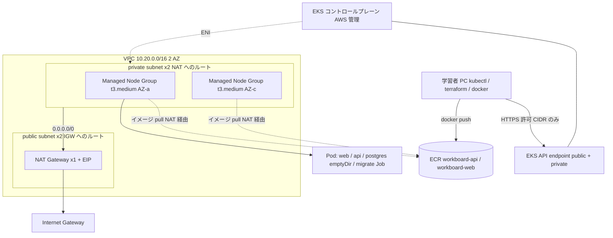

# Phase 6: Amazon EKS 基盤

Phase 3 までの kind に代わり、AWS 上のクラスターで同じ WorkBoard を動かします。入口は `kubectl port-forward`（8086）だけで、ALB は作りません（Phase 7）。DB は使い捨ての Postgres（emptyDir）です。

## 責任分界

| 領域 | AWS が管理 | 利用者が管理 |
| --- | --- | --- |
| コントロールプレーン（API サーバー、etcd） | 可用性、パッチ | Kubernetes バージョンの更新時期、endpoint の公開範囲 |
| ワーカーノード | EC2 の作成・登録、更新時のドレイン（Managed Node Group）、新しい AMI の提供 | AMI の切り替え（更新操作）、インスタンスタイプ・台数、ノード上の脆弱性への対応 |
| アドオン（vpc-cni、kube-proxy、coredns） | 互換性のある版の提供 | 版の更新、設定 |
| ネットワーク（VPC、subnet、NAT、SG） | 部品の提供 | 設計、費用、ルーティング |
| IAM / 認可 | IAM、access entries の仕組み | 誰に何を許すか |
| アプリ・イメージ | ECR の保管 | ビルド、脆弱性、更新 |

## Terraform の構成

| ファイル | 内容 |
| --- | --- |
| `versions.tf` | Terraform / provider のバージョン、`allowed_account_ids`、共通タグ |
| `network.tf` | VPC、IGW、public/private subnet、NAT、ルートテーブル |
| `iam.tf` | cluster role、node role |
| `eks.tf` | クラスター、access entry、Managed Node Group、アドオン |
| `ecr.tf` | ECR リポジトリ、ライフサイクルポリシー |
| `variables.tf` / `outputs.tf` / `terraform.tfvars.example` | 入力と出力（実際の `terraform.tfvars` は Git 管理外） |

## 通信経路

- `kubectl` / `terraform` → API endpoint: public endpoint。許可 CIDR（自分の IP）以外は拒否される。
- ノード → API: private endpoint（VPC 内）。
- ノード → ECR（イメージ取得）: private subnet のルートテーブルの `0.0.0.0/0` → NAT Gateway → IGW。NAT がなければ取得できない。
- `kubectl port-forward` / `logs` / `exec`: API サーバーからノードの kubelet へ（クラスター SG）。
