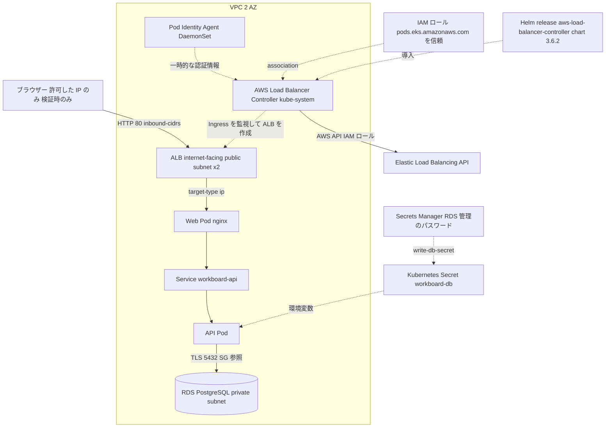

# Phase 7: EKS と AWS マネージドサービス連携

Phase 6 で作ったクラスター・VPC を使い、DB を RDS に移し、入口を ALB にします。Web と API は Stateless で、データは Kubernetes の外（RDS）にあります。この Phase の Terraform は Phase 6 のディレクトリ・state を参照せず、変数 `cluster_name` と data source で既存のクラスターを見つけます。

## 責任分界（DB）

| 観点 | Phase 6 の Postgres（Pod） | RDS |
| --- | --- | --- |
| パッチ・マイナー更新 | 利用者（イメージの更新） | AWS（メンテナンスウィンドウ、`auto_minor_version_upgrade`） |
| バックアップ・復元 | 利用者（なし） | AWS が自動バックアップと PITR、スナップショット |
| 可用性 | Pod の再作成のみ（emptyDir はデータ消失） | 利用者が Multi-AZ を選択 |
| アクセス制御 | クラスター内 Service | SG、subnet の配置、認証、TLS |
| 費用 | ノードの CPU/メモリに含まれる | インスタンス、ストレージ、バックアップ |

## Terraform の構成

| ファイル | 内容 |
| --- | --- |
| `main.tf` | 既存のクラスター、private subnet を data source で参照 |
| `rds.tf` | DB subnet group、セキュリティグループ（ノードの SG からの 5432 のみ）、パラメータグループ、RDS インスタンス |
| `iam.tf` | Pod Identity Agent アドオン、LBC の IAM ポリシー（`policies/` の JSON）とロール、Pod Identity association |
| `policies/aws-load-balancer-controller-v3.6.2.json` | LBC v3.6.2 の公式 IAM ポリシー（出典と SHA-256 は ADR-0014） |

## Kustomize の構成

| 場所 | 役割 |
| --- | --- |
| `kustomize/base/` | Web/API の Deployment と Service、migration Job（Phase 3 の base と同じ。意図的な重複） |
| `kustomize/overlays/eks/` | Namespace、Ingress（`alb`）、ECR のイメージ、ConfigMap（`POSTGRES_HOST`、`PGSSLMODE`）、Secret の generator。Postgres の component は含めない |

## Helm（chart の利用者として）

`helm/aws-load-balancer-controller-values.yaml` が固定した values。`helm template` で ServiceAccount、RBAC、Deployment、Webhook、Secret、CRD、IngressClass を読んでから `helm upgrade --install` します。release の状態は `helm list` / `helm history`、巻き戻しの単位は release の revision（`helm rollback`）。

## 通信と権限の経路

- **公開:** ブラウザー → ALB のセキュリティグループ（`inbound-cidrs` の IP のみ許可）→ Web Pod（IP ターゲット）→ API → RDS。
- **DB:** RDS のセキュリティグループは、EKS のクラスターセキュリティグループからの 5432 だけを許可。RDS は private subnet にあり、public な IP を持たない。
- **AWS API の権限:** LBC の Pod が Pod Identity Agent から一時的な認証情報を受け取り、IAM ロールの権限で ALB・SG・ターゲットグループを操作する。ロールは association で、`kube-system` の ServiceAccount `aws-load-balancer-controller` にだけ結び付く。
- **機密:** RDS のパスワードは Secrets Manager。Kubernetes の Secret には `write-db-secret` で複製される（7 日ごとのローテーションには手動で追従）。
