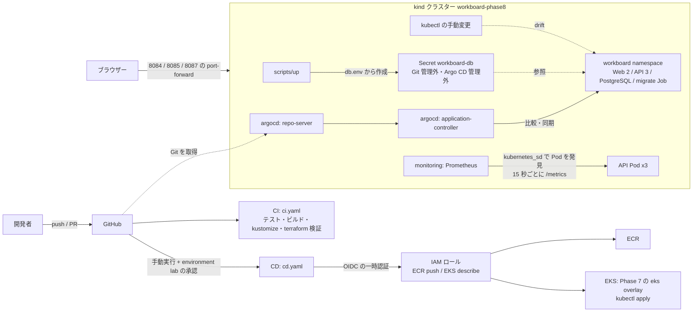

# Phase 8: 配信と可観測性

## 構成

| 要素 | 役割 |
| --- | --- |
| `.github/workflows/ci.yaml` | push・PR ごとに API・Web・ポータルのテスト/ビルド、イメージのビルド、Kustomize の生成、Terraform の検証、スクリプトの構文確認 |
| `.github/workflows/cd.yaml` | 手動実行。environment `lab` の承認後、OIDC で AWS に接続し、ECR へ push、EKS へ適用 |
| `terraform/` | GitHub OIDC プロバイダー、CD 用 IAM ロール（特定のリポジトリ・environment だけが引き受け可）、EKS の access entry（`workboard` namespace の編集権限） |
| kind クラスター `workboard-phase8` | control-plane 1 と worker 2。Argo CD、Prometheus、WorkBoard が入る |
| Argo CD v3.6.1 | `argocd` namespace。Application `workboard` が `kustomize/overlays/kind` を Git から取得して比較・同期する（既定は手動同期） |
| Prometheus v3.15.1 | `monitoring` namespace。`workboard` の API Pod（`app=workboard-api`、ポート 8000）だけを対象にする。保存は `emptyDir` |
| Secret `workboard-db` | `scripts/up` が `db.env` から作成。Git にも Argo CD の管理対象にも入らない |
| 移行 Job | Argo CD の `Sync` hook。同期のたびに作り直す |
| `slo.md` | 学習用 SLI/SLO の定義 |

ポートは、WorkBoard 8084、Argo CD 8085、Prometheus 8087（いずれも `kubectl port-forward` で 127.0.0.1 にだけ公開）。

Phase 4 との違いは、HPA と metrics-server を含まないこと、`overlays/kind` が Secret を生成しないこと、移行 Job に Argo CD の hook があることです。DB（PostgreSQL）は Phase 4 と同じ 1 Pod の StatefulSet で、単一障害点のままです。
